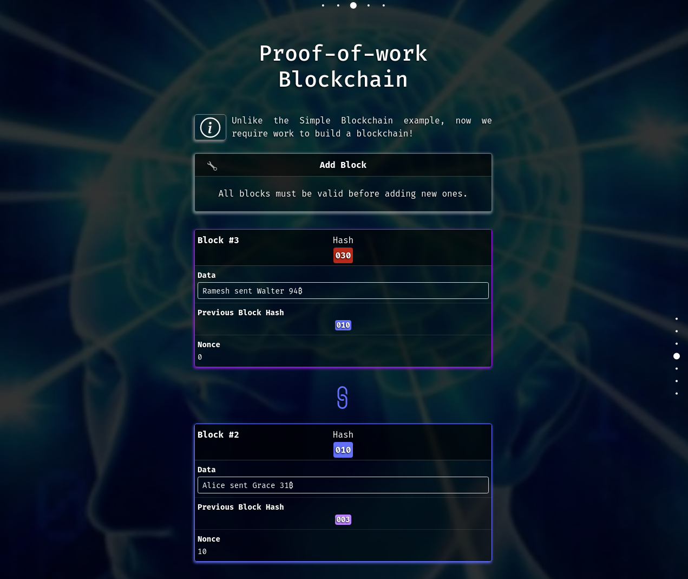
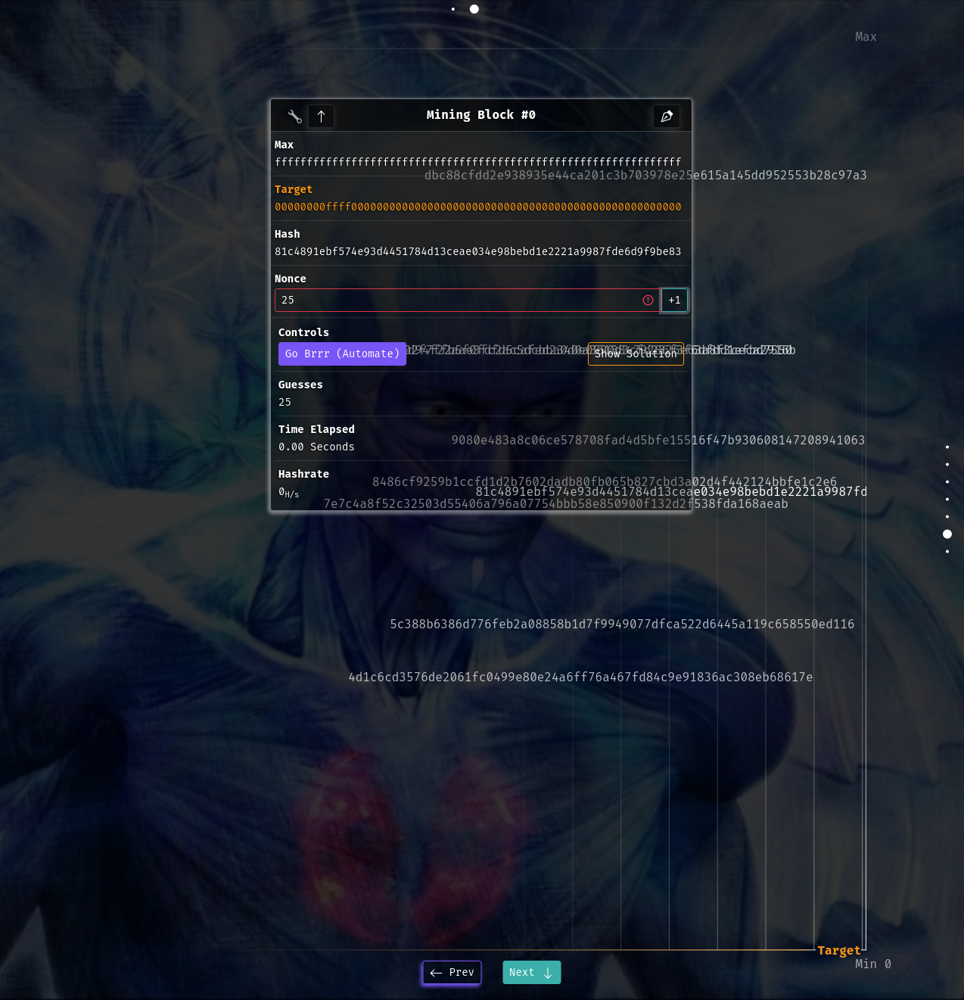

# Timechain Demo

TimechainDemo is an interactive educational site that explains the mechanics of Bitcoin's Timechain.

### TODO fixes:
Timechain mining - if you start and stop the time gets reset. 

Timechain Blockstats - avg time is incorrect. 

When POW target is changed the scroll resets. 

Notation - exponential table overflow
hashrate table overflow
